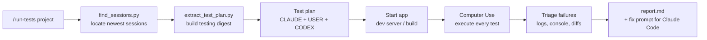

<div align="center">

# run-tests

**Independent, hands-on QA for everything Claude Code builds.**

A Codex skill that reads your latest Claude Code session, turns it into a real test plan,
and runs every test on screen with Computer Use, like a QA engineer clicking through your app.

[](https://agentskills.io)
[](https://developers.openai.com/codex/skills)
[](#requirements)
[](#requirements)
[](LICENSE)

```bash
npx skills add sayginsaman/run-tests-skill -g -a codex
```

</div>

---

## Table of contents

- [Why](#why)
- [What it does](#what-it-does)
- [Installation](#installation)
- [Usage](#usage)
- [How it works](#how-it-works)
- [Permissions and safety](#permissions-and-safety)
- [The report](#the-report)
- [Requirements](#requirements)
- [Repository structure](#repository-structure)
- [Configuration](#configuration)
- [Troubleshooting](#troubleshooting)
- [FAQ](#faq)
- [Contributing](#contributing)
- [License](#license)

## Why

Claude Code is great at building features and usually ends a session with something like *"To test: open the map, toggle the filter, you should see..."*. Those instructions often go unchecked. Unit tests can pass while the button overlaps the screen on mobile, the form double-submits, or the feature Claude called "not yet implemented" quietly ships.

`run-tests` closes that loop. A second, independent agent (Codex) reads exactly what Claude did and said, then verifies it the way a real user would: by looking at the screen, clicking, typing, and reloading.

## What it does

| | |
|---|---|
| **Reads the transcript** | Finds the newest Claude Code session(s) for a project, including Claude desktop app worktree sessions, and extracts requests, approved plans, todo lists, changed files, start commands, URLs, and every testing instruction Claude gave. |
| **Builds a test plan** | Combines tests Claude specified, acceptance criteria from your own requests, and extra high-risk tests Codex adds from a built-in catalog (edge cases, regressions, responsive layout, auth boundaries, error states, accessibility). |
| **Runs it for real** | Starts the app if needed, then executes every test with Computer Use: clicks, forms, file pickers, permission dialogs, viewport sizes, reloads. |
| **Triages failures** | Checks server logs, console output and changed files to label each failure as a new bug, regression, pre-existing issue, or environment problem. |
| **Reports with evidence** | Writes a structured report with reproduction steps and a ready-to-paste prompt you can hand back to Claude Code to fix everything. |

Every test is tagged by origin so you always know why it was run:

- `[CLAUDE]` tests Claude explicitly told you to run
- `[USER]` tests derived from what you asked Claude to build
- `[CODEX]` tests Codex added because a careful QA engineer would

## Installation

### One command (recommended)

```bash
npx skills add sayginsaman/run-tests-skill -g -a codex
```

This uses the open [`skills`](https://github.com/vercel-labs/skills) CLI and installs the skill globally for Codex at `~/.agents/skills/run-tests`. Restart Codex afterwards so it picks up the new skill.

<details>
<summary><b>Other install options</b></summary>

Install for the current project only (commits with your repo):

```bash
npx skills add sayginsaman/run-tests-skill -a codex
```

Install for every supported agent on your machine:

```bash
npx skills add sayginsaman/run-tests-skill -g -a '*'
```

Preview what the repository contains without installing:

```bash
npx skills add sayginsaman/run-tests-skill --list
```

Update or remove later:

```bash
npx skills update run-tests
npx skills remove run-tests -g
```

</details>

<details>
<summary><b>Manual install</b></summary>

```bash
git clone https://github.com/sayginsaman/run-tests-skill.git
mkdir -p ~/.agents/skills
cp -r run-tests-skill/skills/run-tests ~/.agents/skills/
```

Older Codex versions read `~/.codex/skills/` instead. Copy the folder there if the skill does not appear. On Windows the path is `%USERPROFILE%\.agents\skills\run-tests`.

</details>

### Enable Computer Use

1. Open the Codex desktop app and go to **Settings → Plugins**.
2. Install and enable **Computer Use**.
3. Grant the operating system permissions it asks for (Accessibility and Screen Recording on macOS).
4. Optional: pre-approve your browser and the app you test, so runs are not interrupted by approval prompts.

## Usage

In a Codex thread, type:

```text
/run-tests picky
```

Codex does not support user-defined slash commands, so `/run-tests` works through the skill's description matching. You can also invoke it explicitly with `$run-tests` or pick it from `/skills`:

```text
$run-tests picky
```

### Arguments

```text
/run-tests <project> [sessions=N] [session=<id>] [url=<target>] [focus=<area>] [fix]
```

| Argument | Description | Default |
|---|---|---|
| `<project>` | Project folder name, full path, or a distinctive part of the path | asks you if missing |
| `sessions=N` | Number of recent sessions to read | `1`, extends automatically for short or resumed sessions (max 3) |
| `session=<id>` | Use one specific Claude Code session (id prefix is fine) | latest |
| `url=<target>` | URL or app to test against | inferred from the transcript |
| `focus=<area>` | Limit testing to one feature area | everything changed |
| `fix` | After reporting, fix failures and re-verify each on screen | off |

### Examples

```text
/run-tests picky
/run-tests ~/dev/connguard sessions=2
/run-tests meridian url=http://localhost:3000 focus=checkout
/run-tests peak-note session=4f2a9c fix
/run-tests
```

The last form, with no project, lists your most recently active Claude Code projects and asks which one to test.

## How it works



1. **Locate.** `find_sessions.py` scans `~/.claude/projects/` (or `$CLAUDE_CONFIG_DIR`), reads the real working directory stored inside each transcript, and ranks matching sessions newest first. Worktree sessions are grouped with their main repository.
2. **Digest.** `extract_test_plan.py` condenses the JSONL transcript into Markdown: user requests, approved plans, the final todo list, changed files, tagged shell commands (`dev-server`, `test`, `build`, `install`), URLs and ports, every passage about testing or known gaps, and Claude's final message verbatim.
3. **Plan.** Codex reads the digest and the changed files, then writes a test plan with IDs, sources, steps, and expected results. Known gaps Claude admitted to are tested first.
4. **Prepare.** The app is started with the same command Claude used, in the background, with logs captured. Seed data and automated tests mentioned in the session are run as a quick preflight.
5. **Execute.** Each test runs through Computer Use with a result of `PASS`, `FAIL`, `PARTIAL`, `FLAKY`, or `BLOCKED`. Failures never stop the run.
6. **Report.** Results are written to `<project>/.codex-test-runs/<timestamp>/` and summarized in chat.

By default the skill **only tests and reports**. Source code is changed only when you pass `fix`.

## Permissions and safety

The skill gives Codex **full permission inside the app or website under test**, so runs are not blocked by constant confirmation prompts. Within the target app Codex may:

- Click any control, including Delete, Reset, Submit and Save, on test data
- Create test accounts, records, posts and uploads
- Accept permission requests the app raises (camera, microphone, location, notifications, clipboard, file and folder access)
- Open Finder or File Explorer, use file pickers, and grant the app access to folders
- Start, stop and restart the dev server, desktop build, simulator or emulator
- Install the project's declared dependencies when the app cannot start without them
- Resize windows, switch themes, change viewports and throttle the network

To protect your real accounts and data, the skill also enforces clear boundaries:

| Boundary | Behavior |
|---|---|
| Scope | Only the target app, its browser tabs, the project folder, and dialogs the app itself opened |
| Credentials | Test data only. Never your real passwords or cards. Real sign-ins are handed to you |
| Side effects | No real emails, messages or purchases. Such steps are marked `BLOCKED (real side effect)` |
| Files | Nothing deleted outside test fixtures and `.codex-test-runs/`. No destructive git commands |
| Production | Read-only checks only, unless you explicitly allow writes |
| Codex approvals | Codex's own sandbox and Computer Use approvals always stay with you |

## The report

Each run produces `report.md` with:

- A results summary and a one-sentence verdict
- Preflight results from automated tests, lint and type checks
- A full results table with source tags
- Detailed failures: steps to reproduce, expected versus actual, evidence, category, suspected file
- **Claude's checklist coverage**: every test Claude specified, mapped to a result, so nothing slips through
- What was not tested and why
- Test data created during the run
- A **ready-to-paste prompt for Claude Code** listing every failure

```text
.codex-test-runs/
└── 20261009-1830/
    ├── digest.md      # condensed Claude Code transcript
    ├── server.log     # dev server output during the run
    └── report.md      # final QA report
```

Tip: add `.codex-test-runs/` to your project's `.gitignore`.

## Requirements

| Requirement | Notes |
|---|---|
| [Codex desktop app](https://developers.openai.com/codex) | macOS or Windows, with skills support |
| Computer Use plugin | Enabled in Codex settings |
| [Claude Code](https://claude.com/claude-code) | CLI or the Code tab in the Claude desktop app, with at least one session for the project |
| Python 3.8+ | Standard library only, no packages to install |
| Node.js | Only for the `npx skills` installer |

## Repository structure

```text
run-tests-skill/
├── README.md
├── LICENSE
└── skills/
    └── run-tests/
        ├── SKILL.md                     # workflow, permissions, quality bar
        ├── agents/
        │   └── openai.yaml              # Codex display name and invocation policy
        ├── scripts/
        │   ├── find_sessions.py         # locate and rank Claude Code sessions
        │   └── extract_test_plan.py     # transcript to testing digest
        └── references/
            ├── test-catalog.md          # extra tests by app type and change type
            ├── report-template.md       # exact report format
            └── transcript-format.md     # Claude Code JSONL reference
```

## Configuration

All settings are optional environment variables with sensible defaults.

| Variable | Purpose | Default |
|---|---|---|
| `CLAUDE_CONFIG_DIR` | Claude Code data folder | `~/.claude` |
| `CLAUDE_SESSIONS_ROOTS` | Extra folders containing a `projects/` directory (path list) | none |
| `RUN_TESTS_MAX_CHARS` | Max characters per quoted passage in the digest | `1500` |
| `RUN_TESTS_MAX_ITEMS` | Max items per list in the digest | `60` |
| `RUN_TESTS_EXTRA_HINTS` | Extra comma-separated keywords that flag testing passages | none |
| `RUN_TESTS_PROMPT_PREVIEW` | Characters of the first prompt shown in session listings | `120` |

The scripts also work on their own:

```bash
python3 skills/run-tests/scripts/find_sessions.py picky --limit 5
python3 skills/run-tests/scripts/extract_test_plan.py <newest.jsonl> [<older.jsonl>] --out digest.md
```

## Troubleshooting

<details>
<summary><b>The skill does not appear in Codex</b></summary>

Restart Codex after installing. Confirm the file exists at `~/.agents/skills/run-tests/SKILL.md` (or `~/.codex/skills/run-tests/SKILL.md` on older versions) and that skills are enabled. Check `~/.codex/config.toml` for a `[[skills.config]]` entry that disables it.
</details>

<details>
<summary><b>Typing /run-tests does nothing</b></summary>

Use `$run-tests <project>` or pick the skill from `/skills`. Explicit invocation always works.
</details>

<details>
<summary><b>"No Claude Code data folder found"</b></summary>

Claude Code has not created sessions on this machine yet, or uses a custom location. Set `CLAUDE_CONFIG_DIR` to the folder that contains `projects/`.
</details>

<details>
<summary><b>The wrong project or several projects match</b></summary>

Pass the full path instead of the folder name, for example `/run-tests ~/dev/picky`. When several projects match, the skill lists them and asks.
</details>

<details>
<summary><b>Computer Use keeps asking for approval</b></summary>

Pre-approve the browser and the app under test in the Computer Use settings. Codex's own approvals cannot be granted by a skill.
</details>

<details>
<summary><b>The app fails to start</b></summary>

That is reported as test `T00 Smoke` failing, with the error from `server.log`. Codex tries one obvious fix (missing dependencies, port in use) and never edits source code unless you passed `fix`.
</details>

## FAQ

**Does it modify my code?**
No, unless you pass `fix`. Default runs only write to `.codex-test-runs/`.

**Does it work with websites that are already deployed?**
Yes. Pass `url=https://...`. Non-local URLs get read-only checks unless you explicitly allow writes.

**Does it work with desktop and mobile apps?**
Yes. Electron, Tauri, native desktop apps, and iOS or Android simulators are all supported through Computer Use, with dedicated test sections in the catalog.

**Why Codex instead of Claude testing its own work?**
An independent agent with no stake in the implementation catches different mistakes. It reads what Claude claimed and checks it against what actually happens on screen.

**Can I use it with other agents?**
The skill follows the open SKILL.md format, so it installs anywhere the `skills` CLI supports. The workflow is written for Codex Computer Use; other agents with a computer use tool can follow it with minor differences.

## Contributing

Issues and pull requests are welcome. Good contributions include new entries in `references/test-catalog.md`, support for changes in the Claude Code transcript format, and Windows or Linux fixes for the scripts. Please keep the scripts dependency-free and test them against a real transcript before opening a pull request.

## License

Released under the [Apache License 2.0](LICENSE).

<div align="center">
<sub>Built by <a href="https://github.com/sayginsaman">@sayginsaman</a>. Not affiliated with OpenAI or Anthropic.</sub>
</div>
